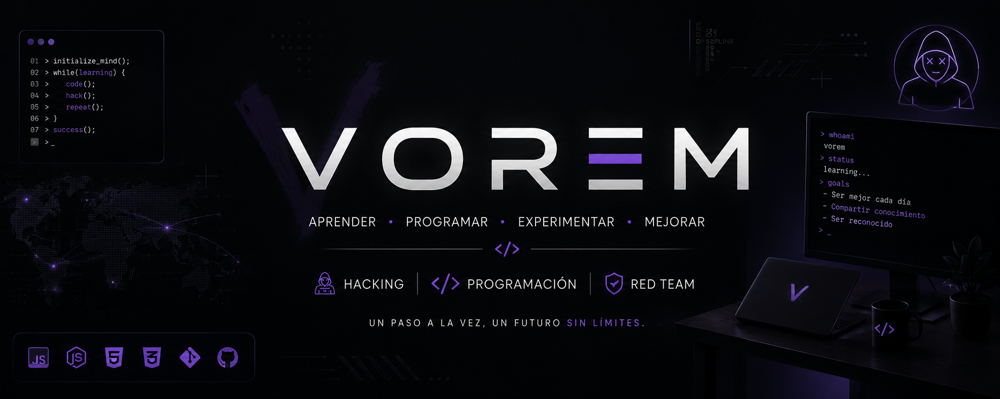

<div align="center">



<br>

# Vorem

### 🛡️ Seguridad Web · 🔴 Red Team · 💻 Desarrollo


</div>

---

## Sobre mí

Soy **Vorem**, operando bajo **Kryptonox Security**.

Me dedico a la **evaluación independiente de seguridad web** — análisis de vulnerabilidades, pruebas de penetración en entornos autorizados y documentación técnica de hallazgos. Mi enfoque está en entender cómo fallan los sistemas antes de que lo haga alguien más.

Trabajo en el cruce entre **desarrollo** y **seguridad ofensiva**: construyo para entender, y entiendo para romper con criterio.

> *Cada sistema tiene una grieta. El trabajo es encontrarla antes que otros.*

---

## Stack

<div align="center">


</div>

---

## Área de trabajo

```
├── Seguridad web ofensiva
│   ├── Evaluación de aplicaciones y portales
│   ├── Análisis de lógica y flujos de negocio
│   └── Documentación de evidencias y vectores
├── Red Team
│   ├── Reconocimiento y enumeración
│   └── Explotación en entornos controlados
└── Divulgación responsable
    ├── Reporte estructurado de vulnerabilidades
    └── Comunicación técnica con equipos de desarrollo
```

---

## 🌐 Encuéntrame

<div align="center">

<a href="https://kryptonox.site">
  
</a>

<a href="https://x.com/vorem_of">
  
</a>

<a href="https://t.co/xNhdNvDYjP">
  
</a>

<a href="https://wa.me/573150736053">
  
</a>

</div>

---

<div align="center">


<br>


</div>
